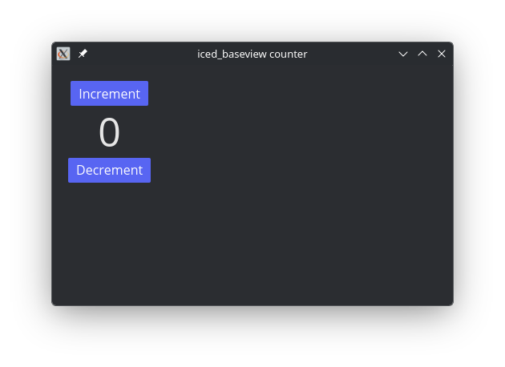

# `iced_baseview`


[](https://codeberg.org/BillyDM/iced_baseview/src/branch/main/LICENSE)

A [`baseview`](https://github.com/RustAudio/baseview) backend for [`Iced`](https://github.com/hecrj/iced). This also contains an adapter for [`NIH-plug`](https://github.com/robbert-vdh/nih-plug) (WIP).

<div align="center">
    
</div>

The [main branch](https://codeberg.org/BillyDM/iced_baseview/src/branch/main) of this repository tracks the latest crates.io release of iced, while [iced_git  branch](https://codeberg.org/BillyDM/iced_baseview/src/branch/iced_git) (WIP) tracks its git repository.

## How to use with custom plugin framework

*TODO*

## How to use with NIH-plug

*TODO*

## Prerequisites

### Linux

Install dependencies, e.g.,

```sh
sudo apt-get install libx11-dev libxcursor-dev libxcb-dri2-0-dev libxcb-icccm4-dev libx11-xcb-dev mesa-common-dev libgl1-mesa-dev libglu1-mesa-dev
```
